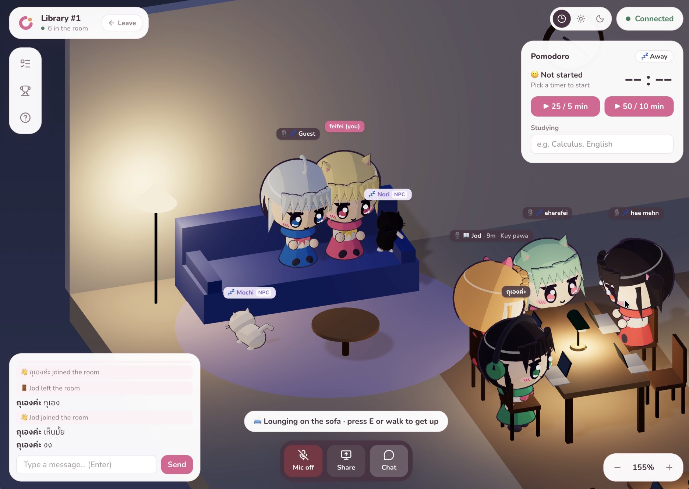

<div align="center">

# 📚 Chanom Study Room

**A cosy 3D library where friends study together online.**
Walk around as an anime chibi, sit at a desk, chat, talk with proximity voice
and run a pomodoro side by side.

### [▶ Play now: studyroom.chanombude.me](https://studyroom.chanombude.me)

<sub>Online during playtests; between them the AWS stack is turned off to save cost.</sub>




</div>

> **Next up: Connecta (V2).** This repo is growing into Connecta, cosy 3D rooms for friend groups to
> hang out, study and play. It's being designed in `demo/`. Developers and coding agents start at
> [`AGENTS.md`](AGENTS.md) and [`docs/v2-plan.md`](docs/v2-plan.md). The rest of this README
> describes V1.

## Features

- **Multiplayer rooms**: up to 20 people per room; a new room opens when one is full. No accounts:
  pick a nickname and an outfit.
- **Presence**: typing dots, speech bubbles and a speaking indicator above each head.
- **Voice and screen share**: proximity voice (louder when closer); screen shares reach only your
  table.
- **Focus**: personal pomodoro (25/5 or 50/10) with your status above your head, to-do list, study
  stats, streaks and a weekly leaderboard.
- **Room friends**: summon library cats and study buddies from the Buddy Machine; pet the cats.
- **Cosy extras**: real-time day and night, personal lo-fi music, a battery saver for slow devices.
- **Phones and tablets**: joystick, action button and a compact layout.
- **Feedback and `/admin`**: a rating card when you leave, and an analytics page behind a password.

### Controls

| Action        | Keyboard              | Phone / tablet      |
| ------------- | --------------------- | ------------------- |
| Walk / run    | WASD or arrows, Shift | Joystick            |
| Sit, pet, use | E                     | Action button       |
| Chat          | Enter                 | Chat button         |
| Camera        | Drag to orbit, scroll | Drag, pinch to zoom |

## Tech stack

| Part      | Tech                                                                    |
| --------- | ----------------------------------------------------------------------- |
| Web       | Next.js 16, React Three Fiber, Tailwind CSS v4                          |
| Real-time | Colyseus 0.18 (authoritative game server)                               |
| API       | Hono (stats, leaderboard, feedback, admin), Drizzle ORM, PostgreSQL     |
| Voice     | LiveKit                                                                 |
| Ops       | Docker Compose, Caddy, Terraform on AWS, GitHub Actions (OIDC)          |
| Observing | Prometheus, Grafana, Loki, Alloy, Alertmanager (SLOs, burn-rate alerts) |

## Getting started

Requirements: Node 24 (`.nvmrc`), pnpm (`corepack enable pnpm`), Docker.

```bash
pnpm install
docker compose up -d     # Postgres (:5433) and LiveKit (:7880)
pnpm dev                 # web :3000, game server :2567, API :2568
```

Open http://localhost:3000. The admin page is http://localhost:3000/admin (dev password
`chanom-dev`). Every setting has a local default; [`.env.example`](.env.example) lists them.

## Commands

| Command                             | What it does                                                |
| ----------------------------------- | ----------------------------------------------------------- |
| `pnpm check`                        | What CI runs: Prettier, typecheck, lint and unit tests      |
| `pnpm e2e`                          | Playwright browser tests (starts the dev servers if needed) |
| `pnpm build`                        | Production builds                                           |
| `pnpm format`                       | Apply Prettier                                              |
| `pnpm --filter @study/game bots 5`  | Five wandering test players                                 |
| `pnpm --filter @study/game load`    | HTTP load for the SLO dashboards                            |
| `pnpm obs:up` / `obs:down`          | Local Grafana (:3001), Prometheus, Loki and Alertmanager    |
| `pnpm infra:up` / `deploy` / `down` | The AWS stack ([infra/README.md](infra/README.md))          |

## Architecture

```
Browser ──HTTPS──▶ Caddy ─┬─ /          ──▶ web   Next.js: lobby, 3D room, /admin
                          ├─ /api/*     ──▶ api   Hono: stats, leaderboard, feedback, admin ──▶ PostgreSQL
                          └─ game.<domain> ─▶ game  Colyseus: rooms, movement, NPCs (WebSocket) ──▶ PostgreSQL
Browser ──WebRTC──▶ LiveKit  voice and screen share (tokens from the game server)
Prometheus, Loki, Alloy, Alertmanager, Grafana watch all of it
```

- **The game server is the authority.** It checks movement (speed budget, walls), seats and timers,
  and runs the NPCs. Each client predicts its own movement, sends numbered moves at 15 Hz and
  corrects only where the server disagreed, so a slow connection doesn't pull you back.
- **The REST API is its own server**, same-origin under `/api` (Caddy in production, a Next rewrite
  in dev): no CORS, a first-party admin cookie, and a typed client (`hc<AppType>`). Restarting it
  doesn't disconnect anyone; restarting the game server does (rooms live in memory).
- **Shared code first.** Room layout, message types and A\* pathfinding live in `packages/shared`,
  so the client and server can't drift apart.
- **Rendering is kept cheap.** Static furniture is merged into a few meshes, shadows are drawn once,
  and battery saver (30 fps, no shadows) turns on by itself on slow devices.
- **Postgres is optional** locally: without `DATABASE_URL` rooms still work, stats and feedback are
  off.

**Production** runs on AWS (`ap-southeast-7`) only during playtests: one EC2 host with Docker Compose
behind Caddy, RDS PostgreSQL, ECR, Route 53, all in Terraform. Pushes to `main` run CI and deploy
through GitHub OIDC (no AWS keys stored). The stack is created with `pnpm infra:up` and removed with
`pnpm infra:down`.

## Project structure

```
apps/
  web/        Next.js client: lobby, 3D room, /admin
  game/       Colyseus server: rooms, movement rules, NPCs
  api/        Hono REST API under /api
packages/
  shared/     Types, room layout and pathfinding used by every app
  db/         Drizzle schema, migrations and queries
infra/        Terraform, production Compose stack, observability config, deploy scripts
```

## Documentation

- [Infrastructure](infra/README.md): AWS setup, deploys and CI/CD
- [Observability](infra/observability/README.md): SLOs, alerts, drills and runbooks

## Credits

Lo-fi tracks by Alex Morgan on [Pixabay](https://pixabay.com/) (royalty-free).
