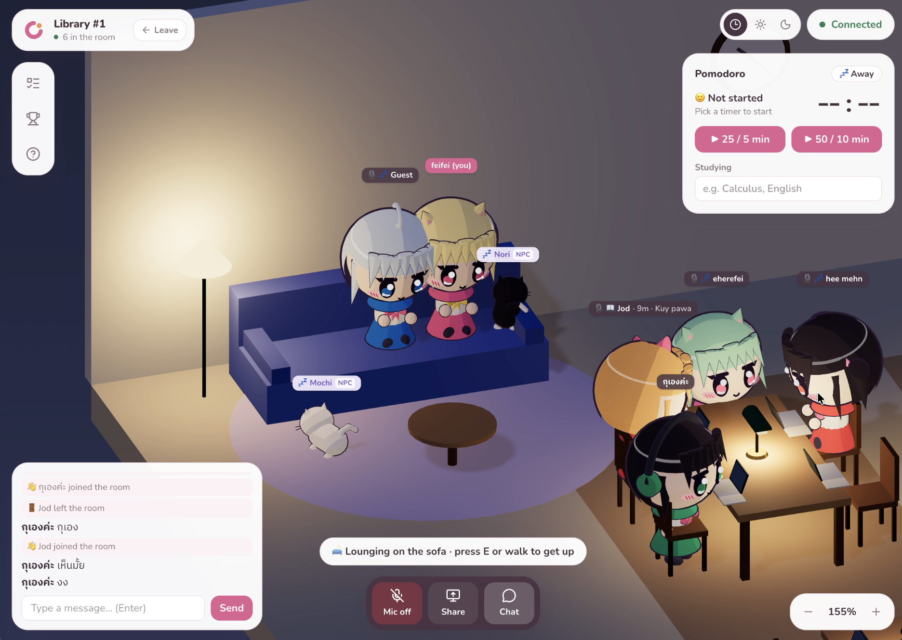

<div align="center">

# Connecta

**Cosy 3D rooms where friend groups and communities hang out, study and play together.**
Walk around as a chibi, sit down at a table, talk with proximity voice, and play together:
chess, card games, Draw & Guess, Pick a Side, watch together.

_Discord is a communication tool; this is a place._



</div>

## Status

Being built. Every feature is designed and approved in `demo/`, a frontend-only prototype with
mock data; the real app in `apps/` is being built from it, one feature at a time. Nothing is
deployed yet. The previous app, Chanom Study Room, is kept at tag `v1.0.0`.

- [The plan](docs/v2-plan.md): status, the concept, every feature, what's left
- [The decision log](docs/v2/decisions.md): why things are the way they are
- [The feature specs](docs/v2/features/)

## Stack

Next.js 16 · React Three Fiber · Tailwind v4 · NestJS 12 · Prisma 7 · PostgreSQL · Redis ·
Colyseus · LiveKit · TypeScript · pnpm + Turborepo

## Getting started

Needs Node 24, pnpm 9 and Docker.

```bash
pnpm install
docker compose up -d
cp apps/api/.env.example apps/api/.env
pnpm db:migrate && pnpm db:seed
pnpm dev          # web http://localhost:3000 · API http://localhost:4000/api/docs
```

Sign in with an email code; it lands in the local inbox at http://localhost:8025. The demo people
sign in as `<handle>@connecta.test`, for example `maimai@connecta.test`.

Developers and coding agents: start at [`AGENTS.md`](AGENTS.md) for commands, layout and the
working agreements.
